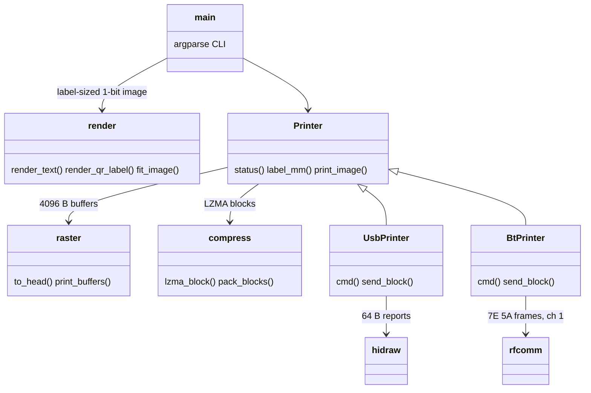

# tprint

Prints text, QR codes or images to a Supvan T50 Pro thermal label printer from Python, over USB (`1820:207f`)
or Bluetooth Classic.

## Setup

```sh
mise run udev      # USB, once: allows non-root access to /dev/hidrawN
bluetoothctl --timeout 10 scan on   # Bluetooth: printer advertises as its serial, e.g. T0205C...
```

Run through [uv](https://docs.astral.sh/uv/) (`uv run tprint.py`), which installs Pillow and
segno. Needs the system Python (3.10+) and `liblzma.so.5` (>= 5.4).

## Usage

```sh
uv run tprint.py "Hello\nWorld"          # label size read from the printer
uv run tprint.py -i logo.png -d 6        # image, darker burn
uv run tprint.py -q https://x.y "Box 12"  # QR code with text beside it (alone if no text)
echo "Box 12" | uv run tprint.py -r      # stdin, text along the feed
uv run tprint.py -s 40x30 -p out.png Hi  # preview only, no printer needed
uv run tprint.py -b A4:93:40:05:6A:13 Hi # over Bluetooth (TPRINT_BT=addr also works)
mise r print-bt -- "Hi"                   # Bluetooth, printer found automatically
uv run tprint.py --status
TPRINT_DEBUG=1 uv run tprint.py ...      # trace frames on stderr
mise run test
```

## Architecture



Protocol reference: [heeen/supvan-cups](https://github.com/heeen/supvan-cups) (MIT).
