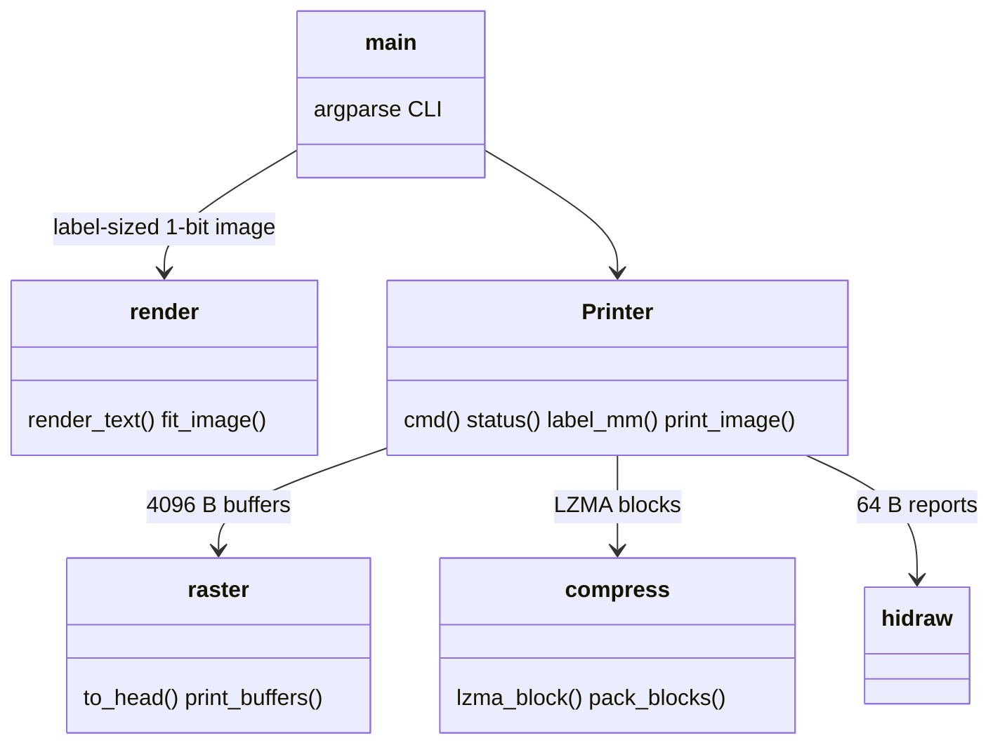

# tprint

Prints text or images to a Supvan T50 Pro thermal label printer (USB `1820:207f`) from Python.

## Setup

```sh
mise run udev      # once: allows non-root access to /dev/hidrawN
```

Requires Python 3.10+, Pillow, and the system `liblzma.so.5` (>= 5.4).

## Usage

```sh
python3 tprint.py "Hello\nWorld"          # label size read from the printer
python3 tprint.py -i logo.png -d 6        # image, darker burn
echo "Box 12" | python3 tprint.py -r      # stdin, text along the feed
python3 tprint.py -s 40x30 -p out.png Hi  # preview only, no printer needed
python3 tprint.py --status
mise run test
```

## Architecture



Protocol reference: [heeen/supvan-cups](https://github.com/heeen/supvan-cups) (MIT).
